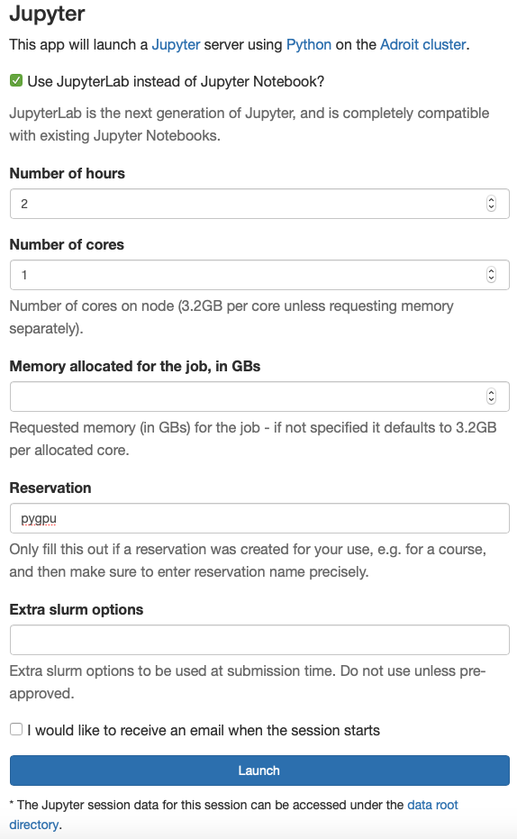

# PyGPU: High performance Python for GPUs

## Henry Schreiner

This minicourse covers ways to speed up your code using GPUs.
Since many of us do not have a reasonable (NVidia) GPU on our
laptops, the course is designed to be run on our local teaching
cluster. You will need to be on the Princeton network, and will
need to be able to access Adroit (registration beforehand required).

## Princeton setup (Adroit)

#### Git clone

Log into our OnDemand site, <https://myadroit.princeton.edu>. You will want to
select "Clusters -> Shell" on the header bar.


Now, you'll want to type:

```bash
git clone https://github.com/henryiii/pygpu-minicourse
```

This will get the course materials. Press <kbd>CTRL</kbd>+<kbd>D</kbd> to quit.

#### Start up a CPU instance

We will be working with a small number of shared GPUs, so you'll want to work
in a CPU only instance, and only submit a notebook to the GPU 1-at-a-time (so
you don't block them for others).

Back on the header bar on the original page, click "Interactive Apps" or "My
Interactive sessions", then select "Jupyter". You should see a page that looks
like this:

> 

Make sure you have **checked the JupyterLab** checkbox, that you have enough
time (at least 2 hours), and that you have entered our reservation (`fallgpu`;
this name changes each term, so use the one given in class).
The slurm options must include `--gres=gpu` (You can include
`--constraint=a100` to set the type of GPU, but don't do that when we are all
sharing GPUs.)

The Anaconda3 version should be `custom`. The module name is
`course/pygpu/default`; the other fields can be left blank.

After you click launch, you should soon see a button that looks like this:


Click it to enter JupyterLab!

### Local setup

If you have an NVidia GPU on Linux, you can install the environment in
`environment.yml`:

```bash
micromamba create -f environment.yml
micromamba run -n gpu-minicourse jupyter lab
```

Conda or Mamba work the same way. You will probably have to choose a kernel when
you launch JupyterLab; the `nb_conda_kernels` package in the environment makes
the course kernel show up.

## Contents

| Notebook                                         | Topic                                                 |
| ------------------------------------------------ | ----------------------------------------------------- |
| `00_intro`                                       | GPU concepts, and the Python GPU library landscape    |
| `01a_fractal_cupy` / `01b_fractal_numba`         | Mandelbrot fractal, the same problem in two libraries |
| `02a_nll_cupy` / `02b_nll_jax` / `02c_nll_torch` | Unbinned negative log likelihood, in three libraries  |
| `02x_torch_autograd`                             | A short look at PyTorch gradients                     |
| `03_nll`                                         | The NLL problem again, CuPy and Numba together        |
| `04_ode`                                         | An ODE solver that is _slower_ on the GPU             |

Each one starts from a NumPy version on the CPU, so you can see what the GPU
actually buys you.

## Running GPU kernels

Load the `ExampleRunner.ipynb` notebook. You can enter the name of a GPU
notebook (without the extension) at the top of the provided cell, and run that
to submit the notebook as a job. It writes an HTML file with the same name,
which holds the output.

## Survey

Link: See chat.
